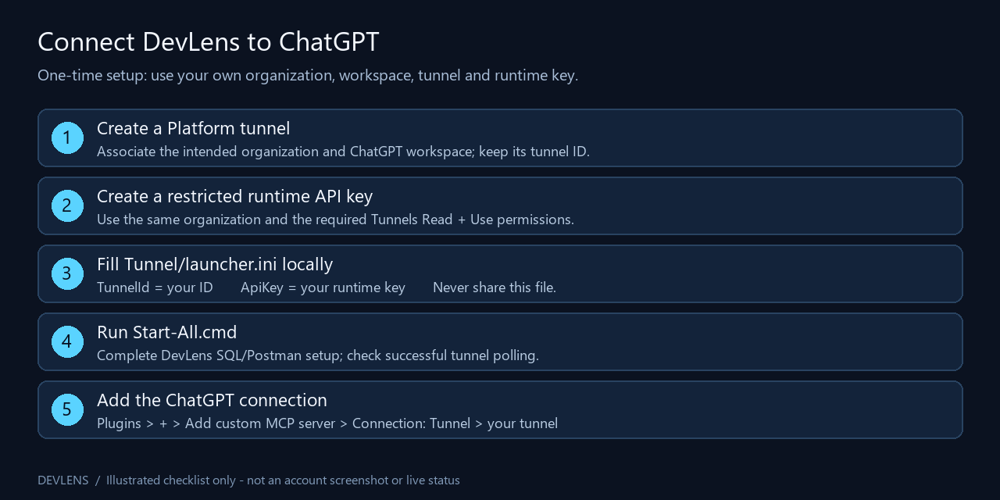
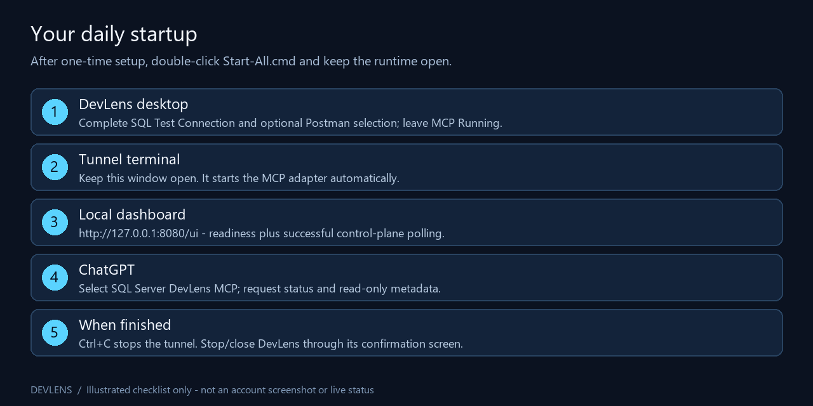

# DevLens: tunnel, API key and ChatGPT setup

**Latest tested update: 0.12.0.** [Tunnel package with Start-All.cmd](https://github.com/santanucompacct/SqlServerDevLens-MCP/actions/runs/39365983048/artifacts/12239920410) · [standard desktop/local-plugin package](https://github.com/santanucompacct/SqlServerDevLens-MCP/actions/runs/39365983226/artifacts/12239755561). These temporary Actions downloads require GitHub sign-in; extract both ZIP layers and check SHA256SUMS.txt. [Upgrade, large-result paging and session authorization](https://github.com/santanucompacct/SqlServerDevLens-MCP/blob/master/docs/RESULTS-AND-AUTHORIZATION.md). Any v0.11.0 Release/downloader links below are the older published version.


Windows x64 portable setup, checked on 19 October 2026. No Visual Studio or separate .NET installation is needed. This guide is for the **tunnel package with Start-All.cmd**; the standard v0.11.0 local-plugin ZIP does not include that launcher.

## What you will set up



*Illustrated checklist, not a screenshot of the Platform UI. Button labels and access can vary. No real account identifiers or credentials are shown.*

You need your own authorized SQL connection, optional Postman API key, OpenAI Platform organization and ChatGPT workspace with custom MCP access. DevLens has been used with a Plus account, but a subscription alone does not establish tunnel/workspace permissions. Check access before subscribing or purchasing anything.

| Item | Where it belongs |
| --- | --- |
| Platform tunnel ID | `Tunnel/launcher.ini`, `TunnelId` |
| Platform runtime API key | `Tunnel/launcher.ini`, `ApiKey` |
| SQL password | DevLens SQL login screen |
| Postman API key | DevLens Postman setup screen |
| ChatGPT custom MCP plugin | ChatGPT Plugins; choose the same tunnel |

These keys are different. Do not put a Postman key or SQL password in the tunnel INI. Do not paste keys into a chat, a screenshot or GitHub.

## 1. Extract the correct package

Use the [Tunnel Windows distribution workflow](https://github.com/santanucompacct/SqlServerDevLens-MCP/actions/workflows/tunnel-distribution.yml). Choose a successful run for the intended commit and download its **DevLens-Tunnel-...** artifact while signed in to GitHub. Actions artifacts are temporary test downloads, not approved releases. Approved tunnel releases, when available, use a `tunnel-*` tag on the [Releases page](https://github.com/santanucompacct/SqlServerDevLens-MCP/releases).

An Actions download has two ZIP layers: extract the artifact ZIP, then extract `SqlServerDevLens-Tunnel-...-win-x64.zip` inside it. The final folder must contain:

```text
Start-All.cmd
published_app/       (desktop application and bundled runtime)
published_mcp/       (MCP adapter and bundled runtime)
Tunnel/
  Start-All.ps1
  Configure-Tunnel.ps1
  Start-Tunnel.ps1
  launcher.example.ini
  tunnel-client.exe
  QUICKSTART.md
```

Keep the complete folder in a permanent, private location. Do not run inside the ZIP. Match the inner ZIP hash from `Get-FileHash -Algorithm SHA256` with `SHA256SUMS.txt` before extraction. A matching hash verifies the download against that build, not that it is free of vulnerabilities.

**Download warning:** Chrome blocked the 39207338884 candidate as dangerous. Defender found no threats in that exact archive or extracted files; Chrome's classification is still unresolved. Do not disable browser/antivirus protection or treat these scans as clearance for a colleague rollout. See [the recorded security checks](DOWNLOAD-VALIDATION.md).

## 2. Create your own tunnel

1. Open [Platform tunnel settings](https://platform.openai.com/settings/organization/tunnels) and select the intended organization.
2. Use the create-tunnel action, give it a recognizable name such as **DevLens - My PC**, and associate the organization and the ChatGPT workspace that will use it.
3. Copy the resulting **tunnel ID** for the INI. This is the identifier beginning with `tunnel_`, not a dashboard URL.

Tunnel creators need **Tunnels Read + Manage**. The runtime key and connector operator need **Read + Use**. An organization owner/RBAC administrator must grant access; project membership alone is insufficient. [Official tunnel and association requirements](https://developers.openai.com/api/docs/guides/secure-mcp-tunnels), [Platform permissions](https://developers.openai.com/api/docs/guides/rbac).

If the page says **Tunnels access required**, resolve organization permissions first. Do not reuse the developer's identity/profile. Colleagues should set up their own identity unless an administrator deliberately manages a shared deployment.

## 3. Create the runtime API key

1. Open [Platform API keys](https://platform.openai.com/settings/organization/api-keys) in the same organization.
2. Use the create-key action. Give it a recognizable name such as **DevLens tunnel runtime**.
3. Use a restricted runtime key with the tunnel permissions above. Avoid granting unrelated administrative access. If the available key/permission UI does not offer the required organization-scoped tunnel access, ask the organization administrator; do not assume any model/project key will work.
4. Copy the secret locally into the INI in the next step. Do not send it to the assistant. Store your recovery copy privately; if it is lost, use Platform key management to create/rotate it.

The launcher consumes an existing key; it does not grant permissions, create an account or fix an incorrectly scoped key. Creation/management credentials do not belong in a daily runtime launcher.

## 4. Fill the INI once

Double-click **Start-All.cmd**. On the first run it creates `Tunnel/launcher.ini`, opens it in Notepad and exits. Fill the two settings, then save and close Notepad:

```ini
[Tunnel]
TunnelId=YOUR_OWN_TUNNEL_ID
ApiKey=YOUR_OWN_PLATFORM_RUNTIME_API_KEY
```

Replace both placeholders with your own values, without surrounding quotes. Alternatively copy `launcher.example.ini` to `launcher.ini` yourself. Make sure Windows has not named it `launcher.ini.txt`.

The completed INI deliberately stores the key in **plaintext** for this development workflow. Restrict access to the folder. Never redistribute your configured folder, completed INI, profile, logs or database exports. Give colleagues a fresh blank package. Completed INIs are ignored by Git and rejected by packaging checks; this does not protect a manually shared folder.

To change the ID/key later, stop the tunnel, edit this same INI and run Start-All.cmd again. No Windows credential-store commands are required. Keep one tunnel process active for this launch path.

## 5. Start everything with one batch file

Double-click **Start-All.cmd** again. It:

1. Starts DevLens, or reuses an already running DevLens desktop instance.
2. Creates/reuses a profile tied to this package path and tunnel ID, without overwriting the old `devlens` profile.
3. Starts the tunnel; its child MCP adapter starts automatically.
4. Opens [the local dashboard](http://127.0.0.1:8080/ui) after readiness responds.

In DevLens, select **SQL Server Only** or **SQL Server + Postman**. Enter SQL details and Test Connection. In combined mode, also select your Postman workspace/collection. Leave the MCP server screen **Running**. The batch does not automatically log in to SQL or approve actions.



*Operational illustration, not a screenshot or evidence of a live connection.*

Dashboard readiness alone does not establish an authenticated connection: the earlier wrong-key test returned ready while control-plane polling failed. Check successful polling in the dashboard or run this read-only diagnostic from the package root:

```powershell
.\Tunnel\tunnel-client.exe health --port 8080 --require-control-plane-poll --json
```

Expect successful health, readiness and control-plane polling. If the browser does not open, visit the dashboard manually and inspect the terminal. The watcher stops trying after approximately one minute. Port 8080 is an operator dashboard, **not** the MCP URL to paste into ChatGPT.

## 6. Add the MCP connection in ChatGPT

Keep DevLens Running and the tunnel healthy during discovery.

1. In the intended ChatGPT workspace, open **Plugins → + → Add custom MCP server**.
2. Choose **Connection: Tunnel** and select your tunnel or enter its ID.
3. Name the connection **SQL Server DevLens MCP**. Follow the authentication options appropriate to the deployment. This packaged stdio host does not implement a separate OAuth server; do not invent an OAuth URL or paste the runtime key as MCP-server authentication.
4. Review the risk warning and use **I understand and want to continue**, then **Create as a plugin**.
5. Enable/select that connection in the chat using its plugin selector or `@` picker when offered.

These are the current [official ChatGPT tunnel steps](https://developers.openai.com/api/docs/guides/secure-mcp-tunnels). Missing controls require workspace/account access checks; a prompt cannot grant access. If the tunnel is missing, check its workspace association and operator permissions.

This connects the existing DevLens MCP server; it does not generate a new database server or require a hosted public MCP endpoint. Do not use the SQL host, port 1433 or `127.0.0.1:8080/ui` as an MCP server URL. The optional Install-Plugin.cmd installs a different **local desktop plugin** and is not needed to create this tunnel connection. Installing a remote connector does not by itself install the local workflow skill into every account.

## 7. Verify from the chat

For SQL only, copy:

```text
Use the connected SQL Server DevLens MCP plugin. Call get_server_status and get_database_info. Report the actual selected database and whether both calls succeeded. Begin with read-only inspection. Prepare each procedure execution or SQL change separately, and wait for explicit approval in DevLens before applying it. Do not ask for credentials or automatically retry an uncertain action. If tools are missing, say so.
```

For SQL + Postman, copy:

```text
Use the connected SQL Server DevLens MCP plugin. Call get_server_status, get_database_info and get_postman_selection. Confirm the database, workspace, collection and whether Postman execution is enabled. Work only within that selection. Begin with read-only inspection. Prepare each procedure execution, SQL change, Postman change or HTTP run separately and wait for approval in DevLens. Do not expose credentials or automatically retry uncertain actions. If tools/setup are missing, report that limitation.
```

Success means actual tool responses, not the assistant saying it can connect. SQL metadata proves a database read; Postman selection is a metadata snapshot and does not prove an HTTP request ran. `sqlConnected: false` is normal because SQL connections open and close for each operation. This operator's one-click setup was followed by successful remote status, SQL metadata and Postman selection calls on 19 October 2026; a new user's authenticated setup remains to be tested independently.

## Daily use, shutdown and upgrades

- **Every day:** Start-All.cmd, complete DevLens connection setup, leave the app and terminal open, then select the existing ChatGPT connection. Do not recreate the tunnel/key/connector daily.
- **Stop:** Ctrl+C in the tunnel terminal stops forwarding. Stop/close DevLens through its confirmation UI separately.
- **New folder/build:** stop the old tunnel and desktop, extract the entire new build, privately configure its INI and launch. A new path creates a separate adapter profile. If you retain the same tunnel ID/workspace, verify the existing ChatGPT connection before recreating it.
- **Port already in use:** stop the old tunnel. Do not start multiple launchers to repair an SQL login error.
- **Ready but ChatGPT says client not seen:** inspect successful control-plane polling, then the INI key, organization and key permissions. Correct locally and restart; do not post the INI.
- **desktop_unavailable:** finish DevLens setup until Running, then retry status. Both components must run under the intended Windows user.
- **No tools in this chat:** enable/reconnect the intended remote plugin, check discovery and try a new chat. A local skill alone is not a working remote tool connection.

Maintainer architecture, build and release gates: [setup and verification record](../docs/TUNNEL_SETUP_AND_RELEASE.md).
